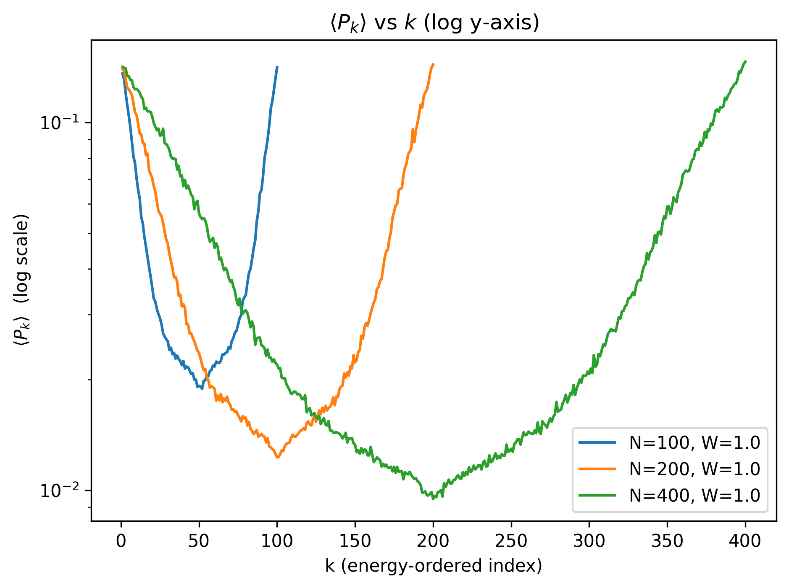
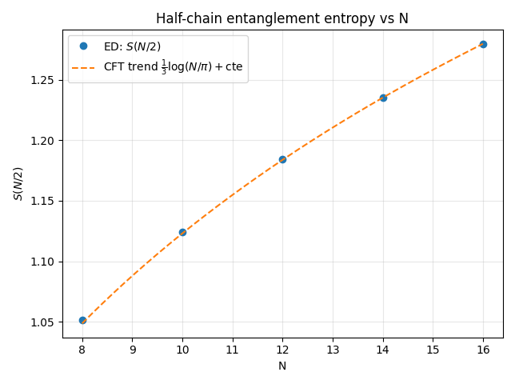
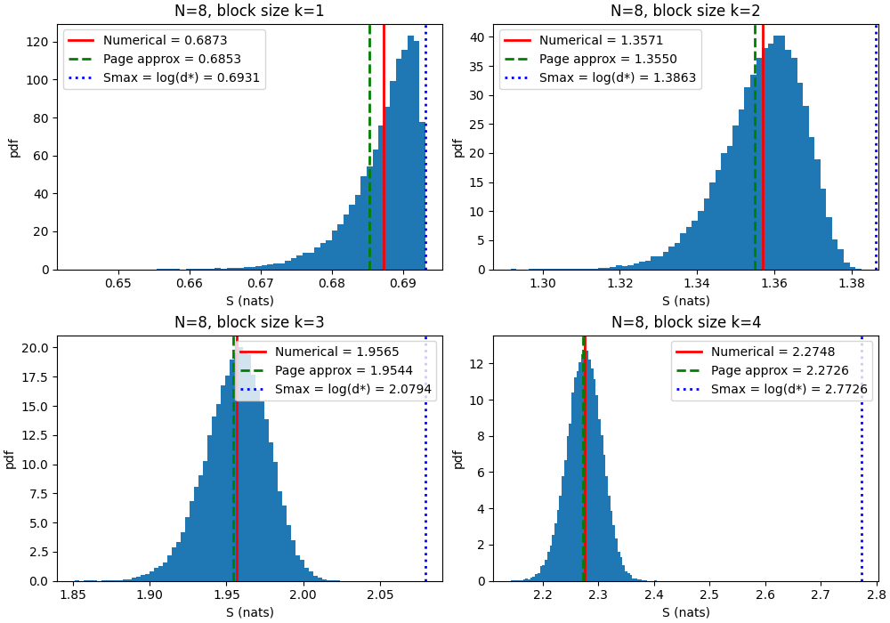

# Quantum many-body numerics

Exact diagonalisation, mean-field, Monte Carlo and free-fermion methods for 1D quantum lattice models: transverse-field Ising and Heisenberg chains, interacting and disordered fermions, and random-state entanglement. Written in Python (NumPy, SciPy sparse) for the Computational Quantum Physics course of the M.Sc. in Advanced Physics (Computational Physics), UNED.


*1D Anderson model with disorder W = 1. Average inverse participation ratio P_k = Σᵢ |ψᵢₖ|⁴ of each eigenstate (300 disorder realisations) for N = 100, 200 and 400. Band-edge states stay strongly localised (P_k ≈ 0.15 for every N). Band-centre states have localisation lengths comparable to the system size, so their P_k keeps falling as N grows.*

| Folder | Model | Methods | What it computes |
|---|---|---|---|
| [`01-transverse-field-ising-ed-and-pimc`](01-transverse-field-ising-ed-and-pimc) | Transverse-field Ising chain, H = −Σ σᶻσᶻ − Γ Σ σˣ (N = 4–8, periodic); harmonic oscillator | Full exact diagonalisation built from Kronecker products; path-integral Monte Carlo (2,000 beads, adaptive Metropolis step) | Ground-state energy, gap, magnetisations, correlation maps and entanglement entropy vs Γ; imaginary-time paths and position distribution |
| [`02-fermion-and-spin-chains`](02-fermion-and-spin-chains) | Spinless fermions with hopping and nearest-neighbour repulsion; Heisenberg XXX chain; 1D Anderson model; Haar-random states | Sparse ED at fixed particle number (Jordan–Wigner signs) vs self-consistent Hartree–Fock; sparse Lanczos (`eigsh`); disorder averaging | ED vs HF errors in energy and gap; gap and half-chain entanglement entropy vs N; inverse participation ratios and effective localisation lengths; entanglement of random states vs the Page formula |
| [`03-tfim-subsystem-passive-energy`](03-tfim-subsystem-passive-energy) | Transverse-field Ising chain with open ends, half-chain subsystem | Free-fermion (Bogoliubov–de Gennes / Majorana covariance) techniques for chains up to hundreds of sites | Subsystem energy, entanglement spectrum and passive-state energy of the half chain, compared with asymptotic formulas from the literature |

## Results

<p>


</p>

- **Left:** half-chain entanglement entropy of the Heisenberg chain ground state (ED, N = 8–16). It follows the conformal-field-theory trend (1/3) log(N/π) + const expected for a c = 1 critical chain.
- **Right:** entanglement-entropy distributions for 50,000 Haar-random 8-qubit states. The numerical means agree with Page's approximation to within about 0.002 nats for every block size.

## Usage

```bash
pip install -r requirements.txt

# 01 – run from inside the folder
python main.py     # TFIM: ED scan in the transverse field
python PIMC.py     # path-integral Monte Carlo (slow)

# 02
python main_problem_1.py    # ED vs Hartree–Fock
python main_problem_2.py    # Heisenberg chain
python main_problem_4.py    # Anderson localisation (figures in ./figures)
python main_problema_5.py   # Page curve

# 03
python original.py          # subsystem and passive energies (figures in ./figures_original)
python main.py              # comparison with asymptotic formulas
```

Code comments are partly in Spanish.
